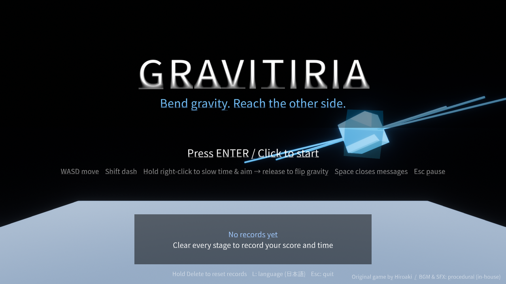
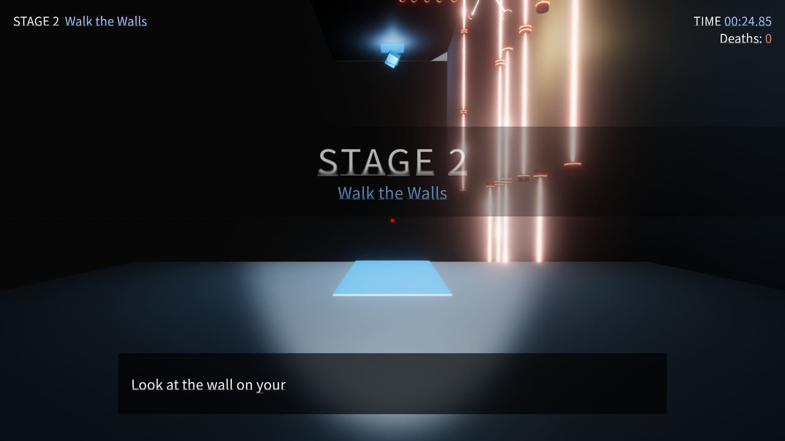
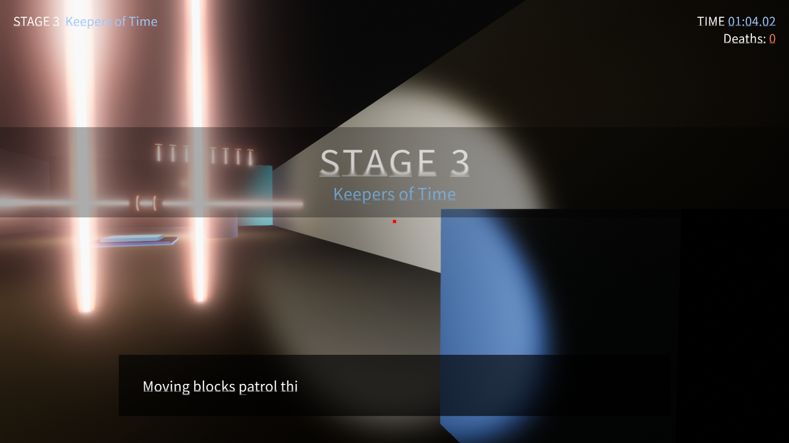
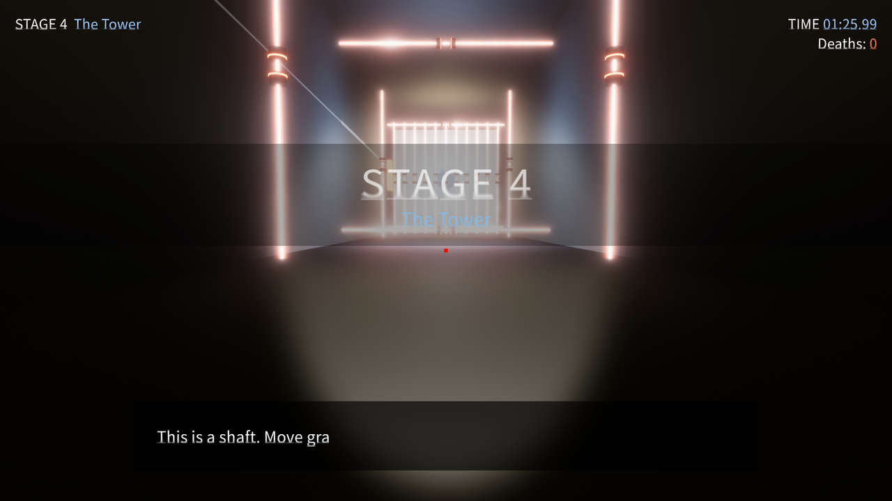
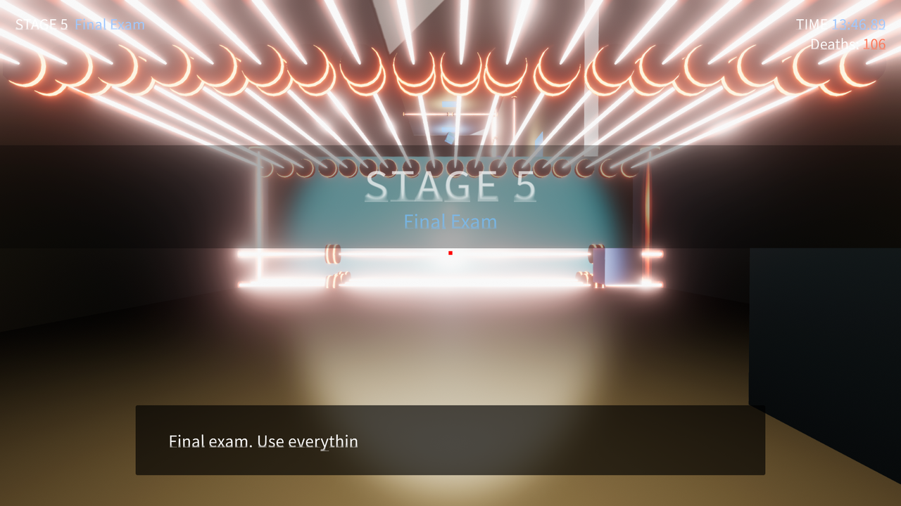
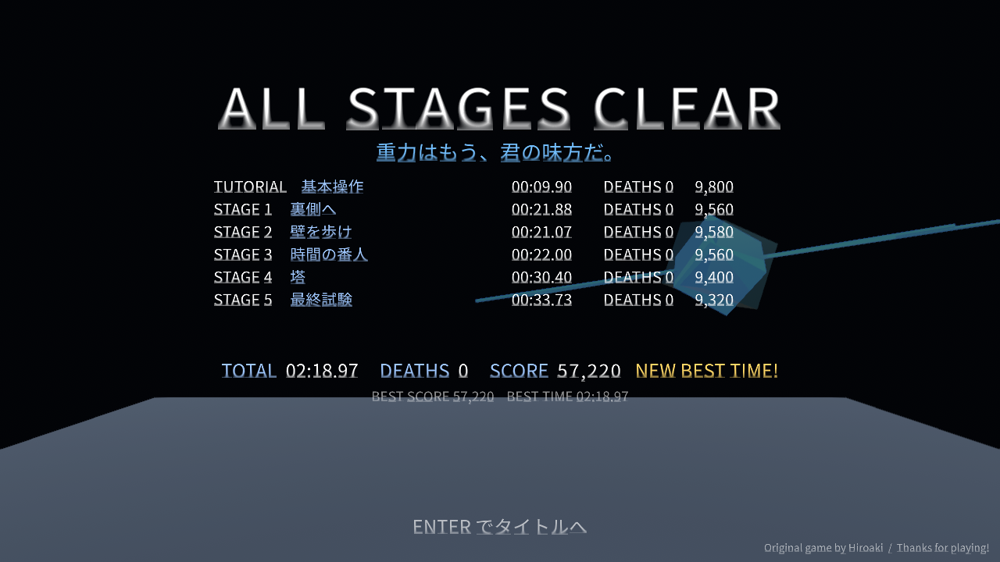

# Gravitiria — 重力を操り、裏側へ

*English: see [README.md](README.md).*

一人称の重力パズルアクション。右クリックで時間を遅らせて照準を合わせ、離した瞬間に **見ている面へ重力が切り替わる**。壁を床に、天井を道に変えながら、レーザーと「時間に逆らう」番人をかいくぐってゴールを目指す。

*A first-person gravity puzzle. Hold right-click to slow time and aim; release to make the surface you are looking at become "down". Walk on walls and ceilings, slip past security lasers and time-defying sentinels, and reach the white goal.*



| STAGE 2 壁を歩け | STAGE 3 時間の番人 | STAGE 4 塔 | STAGE 5 最終試験 |
|---|---|---|---|
|  |  |  |  |



## 遊び方 / How to play

| 操作 | Key |
|---|---|
| 移動 | W A S D |
| ダッシュ | Shift |
| スロー＆照準 → 重力反転 | 右クリック長押し → 離す |
| 無線メッセージ（字幕）を閉じる | Space |
| ポーズ（再開 / やり直し / タイトル） | Esc（R / T） |
| タイトル：開始 / 言語切替 / 記録リセット / 終了 | Enter または クリック / L / Delete 長押し / Esc |

- **言語 / Language**: OS が日本語なら日本語、それ以外は英語で起動する。タイトル画面の `L` で切り替え（保存される）。起動引数 `-lang ja` / `-lang en` でも指定可。
  *The game starts in Japanese on a Japanese OS and in English otherwise. Press `L` on the title screen to switch (remembered), or launch with `-lang en` / `-lang ja`.*

- **ゴール**：白く光る回転する箱に触れると次のステージへ。
- **レーザー**：触れると即リセット。近づくと画面が赤く明滅する。見た目は専用シェーダー `Gravity/LaserBeam`（視線角で縁が溶けるフレネル減衰＋加算合成＋流れる縞と光のパケット）で描く極細の白熱コア／赤いグロー／ハローの 3 層に、両端の発射口（金属シリンダー＋発光リング）。`LaserBeamVisual` が脈動を付け、Post Processing のブルームでにじむ（`Tools > Gravity > Style Lasers` でプレハブに再適用）。
- **跳躍パッド**：光る板を踏むとその面から跳ね上がる。横に張られたレーザーを飛び越えるのに使う。
- **停滞フィールド**：青い霧の中では自分も番人も動きが鈍る。
- **番人（動く箱）**：時間に逆らう存在。スローをかけると逆に加速するので、近くでは右クリックを使わないこと。
- **スイッチ**：光る板に触れると、紐づいたレーザーが消える（STAGE 4 の天井）。死亡でやり直すとレーザーも戻る。
- **落下**：ステージの外へ落ちると自動でやり直し。
- **タイム / Deaths**：右上のタイムと死亡数は死亡・やり直しでは戻らない。最初からやり直す（タイトルから開始する）時だけリセット。
- **記録**：各ステージのクリアタイムと死亡回数からスコアを算出。全ステージクリアでベストスコア／ベストタイムが保存され、タイトル画面に表示される。

## ステージ構成 / Stages

| | タイトル | 学ぶこと |
|---|---|---|
| TUTORIAL | 基本操作 | 移動と重力反転 |
| STAGE 1 | 裏側へ | スタートの背後から部屋を出て床の裏へ。裏側のレーザー柵は左右交互の隙間を抜ける |
| STAGE 2 | 壁を歩け | 壁を床にして進み、塞がれたら天井へ |
| STAGE 3 | 時間の番人 | 番人の廊下、跳躍パッド、停滞フィールド |
| STAGE 4 | 塔 | 縦穴を壁伝いに登り、レーザーの帯ごとに壁を乗り換える。天井は一面レーザー、北の壁のスイッチで解除 |
| STAGE 5 | 最終試験 | 床 → 壁 → 天井、すべてを繋げて脱出 |

## ビルド / Build

- Unity **6000.x**（開発は 6000.5.10f1、6000.0.3f1 でも開ける）。`Packages/manifest.json` は 6000.0 / 6000.5 の両方で解決できる最小構成にしてある：組み込みモジュール（両バージョンに共通するもの）＋ `com.unity.ugui` 2.0.0（TextMesh Pro 同梱。6000.5 では内蔵の 2.5.0 が使われる）＋ Post Processing（埋め込み）。6000.5 固有のモジュール（adaptiveperformance / physicscore2d / vectorgraphics）や `com.unity.modules.vr`（6000.5 に無い）は書かない。スクリプトも両バージョンに存在する API だけを使う（`FindObjectsByType<T>(FindObjectsInactive, FindObjectsSortMode)`、`enableWordWrapping` など。6000.5 では非推奨警告が出るが意図的）。
- Post Processing 3.4.0 は Unity 6000.5 で削除された `EndNameEditAction` を使っていてコンパイルできないため、`Packages/com.unity.postprocessing/` に埋め込み、`PostProcessing/Editor/Tools/ProfileFactory.cs` だけ修正している（プロファイル作成メニューの挙動のみ変更）。ブルーム設定は `Assets/Settings/GravityPostFx.asset`、各カメラへの適用は `Assets/Editor/PostFxSetup.cs`。
- Windows 64bit のプレイヤーをコマンドラインから作る:

```bash
"C:\Program Files\Unity\Hub\Editor\6000.5.10f1\Editor\Unity.exe" -batchmode -nographics -quit -projectPath "<このフォルダ>" -executeMethod BuildScript.BuildWindows -outputDir "<出力先>" -logFile build.log
```

- Editor から: `Tools > Gravity > Generate Levels` で Level2〜5・Title・Ending を再生成（Level1 を雛形に、`Assets/Editor/LevelGenerator.cs` の座標データから組み立てる）。

## 開発者向け / Developer notes

- **自動プレイ検証**: `Gravitiria.exe -autopilot Tools\autopilot_full_run.txt -capture <dir>` で、台本に沿ってタイトル → 全ステージ → エンディングまで自動で通し、各シーンのスクリーンショットを `<dir>` に保存する。結果は `%USERPROFILE%\AppData\LocalLow\DefaultCompany\Gravitiria\Player.log` の `[AutoPilot]` 行で確認できる。`-startScene Level3 -autopilot Tools\autopilot_death_test.txt` は死亡時にタイム／死亡数が保持されることの確認用（`[GameSession]` 行）。
- **音源**: BGM・SFX はすべて `Tools/make_audio.py`（numpy のみ）で合成した自作素材。`python Tools/make_audio.py Assets/Resources/Audio` で再生成できる。
- **字幕**: `Assets/Resources/SubtitleUI.prefab` を `SubtitleManager` がシーンに無ければ自動生成する。日本語は Noto Sans JP（動的アトラス）。
- **主要スクリプト**: `GravityController`（移動・重力反転・スロー）、`GameSession`（タイム／死亡／スコア／HUD／ポーズ）、`GoalDoor`、`SecurityLaser`、`GravityPad`、`StasisZone`、`TimeDefyingEnemy`、`SubtitleManager`、`MusicPlayer`、`SfxPlayer`、`TitleScreen`、`EndingScreen`。

## クレジット / Credits

- Original game design & levels 1: **Hiroaki**
- Levels 2–5, game flow, UI, music & sound: Gravity contributors
- Font: [Noto Sans JP](https://fonts.google.com/noto/specimen/Noto+Sans+JP) (SIL Open Font License 1.1)

License: MIT (see `LICENSE`).


## Remix（この派生版で追加したもの）

| 追加 | 内容 |
|---|---|
| 入力の抽象化 | `GameInput` ＋ `IInputSource`（キーボード／マウス、ゲームパッド、タッチ用の `TouchInputSource`）。スクリプトは `UnityEngine.Input` を直接触らない |
| 敵 | `Enemy` 基底（重力に従って落ちる／レーザーで消える／触れると死亡）。`PatrolDrone`（往復）、`Magnet`（接近）、`LaserTurret`（弾を発射）。敵もスイッチを押せる |
| 動き | ダッシュ（短い突進＋無敵＋クールダウン）、クイック重力（視点基準で左右上下へ一発反転）。ピックアップで解放、説明文なし |
| ステージ | REMIX 1〜5（R1〜R5）。ヒント文なし。スイッチと対応レーザーは同色、床の光る帯で誘導 |

### 操作（Remix）

| 操作 | キーボード / マウス | ゲームパッド | タッチ（Android） |
|---|---|---|---|
| 移動 | WASD / 矢印 | 左スティック / 十字キー | 画面左半分に指を置いて動かす（置いた所が中心の仮想スティック） |
| 視点 | マウス | 右スティック | 画面右半分をスワイプ |
| 照準＆スロー → 重力反転 | 右クリック長押し → 離す | South(A) 長押し → 離す | **重力** ボタン長押し（押したままドラッグで狙う）→ 離す |
| ダッシュ（解放後） | Shift | West(X) | **DASH** ボタン |
| クイック重力（解放後） | Q / E（左右）、Z / C（下上） | 照準ボタン + 十字キー | 重力ボタンの上の ▲▼◀▶ |
| ポーズ / やり直し / タイトル | Esc / R / T | Start / North(Y) / Back | 右上の **II** → 再開 / やり直す / タイトルへ のボタン |
| 決定 / 字幕を閉じる | Enter, クリック / Space | South(A) / East(B) | タップ（ステージ中は画面右側を短くタップ） |
| 言語切替（タイトル） | L | — | 右上の言語ボタン |

### Remix ステージの想定解法（ネタバレ）

- **R1 反転と鍵**: 床の赤い柵を右→左→右→左の隙間で抜け、奥の青いボタンを踏むと天井の青いレーザーが消える。天井を狙って反転し、天井を戻って出口へ。入口直後の水色の結晶でダッシュ解放。
- **R2 裏口**: 入口はスタートの背後。後ろの縁から落ち、床の裏を狙って反転。裏側の赤い柵は右→左。桃色の十字でクイック重力解放。
- **R3 誘導**: 赤い柵を抜けて奥の黄色いボタン → 黄色い壁が消え、ドローンの巡回が伸びる → ドローンが低いトンネル内の緑のボタンを押す → 緑の門が開く。
- **R4 点滅**: 位相の違う 3 列の点滅レーザー。消えた瞬間に抜けるか、ダッシュの無敵で抜ける。
- **R5 総合試験**: 赤い柵を左で抜け、砲台の射線（中央）を避けて右壁の高い青ボタンへ（クイック重力か照準で壁へ）。裏側の青い門が開くので、後ろの縁から床の裏へ回って出口へ。磁石の敵は砲台の弾で消える。

### 検証

- `Build\Gravitiria.exe -startScene R1 -autopilot Tools\autopilot_full_run.txt` で R1 → Ending を自動で通す（R1〜R5 の台本は各ステージの想定解法そのもの）。
- 砲台の弾やドローンは決定論的に動くため、台本では横断の時刻を `wait` でずらしている。

## Android 対応

### タッチ操作（実装済み）

- `Assets/Script/Input/TouchInputSource.cs`: タッチを `IInputSource` に変換する（左半分＝仮想スティック、右半分＝視点スワイプ、ボタン、短いタップ＝決定／字幕を閉じる）。
- `Assets/Script/Input/TouchControls.cs`: 画面上の UI（スティック、重力 / DASH / ポーズ、解放後のクイック重力、ポーズメニュー、タイトルの言語ボタン）。`Screen.safeArea` の内側に置き、ノッチ・丸角を避ける。実機（`Application.isMobilePlatform`）では自動で有効、PC では非表示。
- 重力反転は PC と同じ「長押し → 離す」。押したまま指を動かすと視点が回るので、スロー中に狙いを調整できる。
- 小さい画面向けに HUD と字幕の文字を 1.3 倍にし（`UiKit.HudScale`）、HUD は右上のポーズボタンを避けて内側に寄せる。
- 実機では `Application.targetFrameRate = 60`（Android の既定は 30）、プレイ中は画面を消さない。

### PC / エディタでの確認

- **Device Simulator**: Game ビューの左上のドロップダウンで *Simulator* に切り替える（Window > General > Device Simulator）。端末の解像度・セーフエリアで表示され、マウスが 1 本指のタッチになる。
- **デバッグ切替**: 起動引数 `-touchui` でタッチ UI を強制表示。Development Build とエディタでは **F10** で切り替えられる（PC ではマウス左ボタンを 1 本指として扱う）。
- **自動テスト**: `Build\Gravitiria.exe -touchui -autopilot Tools\autopilot_touch_test.txt -capture <dir>` で擬似タッチ（`tdown/tmove/tup/tbutton/tlog`）によりスティック移動・視点スワイプ・重力ボタン長押し→反転・ポーズ→再開・タップを通す。結果は `Player.log` の `[AutoPilot] tlog` 行。

### ビルド設定（`Assets/Editor/AndroidBuildSettings.cs`）

メニュー **Build > Android > Apply Player Settings** または CLI で適用する。値の根拠は Unity 6.5 マニュアル（Android requirements and compatibility / Android Player settings）と Google Play の Target API level 要件。

| 設定 | 値 | 根拠 |
|---|---|---|
| Package Name | `com.vyth.gravityremix`（仮案） | 公開前に決める |
| Minimum API Level | 26 (Android 8.0) | Unity 6.5 の対応下限が API 26 |
| Target API Level | Automatic (highest installed) = 36 | Google Play は 2026-08-31 以降 API 36 以上を要求（既存アプリは 35 以上） |
| Scripting Backend | IL2CPP | ARM64 は IL2CPP でのみ選択可 |
| Target Architectures | ARM64 | 64bit のみ。APK を小さく保つ |
| Default Orientation | Landscape Left（自動回転は横 2 方向） | HUD・字幕・タッチ UI が横画面前提 |
| Render Outside Safe Area | 有効 | 全面に描き、UI 側で `Screen.safeArea` を避ける（Android 15 以降は既定で全面） |
| Graphics API | Auto（Vulkan → GLES 3.2 / 3.1 / 3.0） | Unity の既定 |
| Texture Compression | ASTC | Unity の既定 |
| 形式 | Development Build + APK（AAB ではない） | 実機に `adb install` するため |

### APK を作って実機に入れる

1. Unity Hub → Installs → 6000.5.10f1 の歯車 → *Add modules* → **Android Build Support**（OpenJDK / Android SDK & NDK Tools）。この PC では導入済みで、Preferences > External Tools は `%LOCALAPPDATA%\Unity\AndroidTools` の OpenJDK 17 / SDK（platforms android-36, build-tools 36.0.0）/ NDK r27c を指している。
2. エディタ: File > Build Profiles > Android > *Switch Platform* → **Build > Android > Build Development APK**。
   CLI:
   ```
   "C:\Program Files\Unity\Hub\Editor\6000.5.10f1\Editor\Unity.exe" -batchmode -quit -nographics -buildTarget Android -projectPath "<このフォルダ>" -executeMethod AndroidBuildSettings.BuildDevelopmentApk -logFile Build\build_android.log
   ```
   出力は `Build\Android\Gravitiria.apk`。
3. 端末側: 設定 > デベロッパー向けオプション > **USB デバッグ** を有効にし、USB で接続して「このコンピュータからの USB デバッグを許可」。
4. インストール: `adb install -r Build\Android\Gravitiria.apk`（`adb devices` で端末が `device` と出ること）。
5. ログ: `adb logcat -s Unity` で `[AutoPilot]` や例外を確認できる。

### 実機チェックリスト

- [ ] 起動して横向きで表示され、ノッチ側にボタンや HUD が隠れない
- [ ] タイトル: タップでスタート、右上のボタンで言語が切り替わる
- [ ] 左半分で移動、右半分のスワイプで視点が回る
- [ ] 重力ボタン長押しでスロー＆ズーム、押したままドラッグで狙いが動き、離すと反転する
- [ ] 字幕が読める大きさで、右側のタップで閉じる。最初の字幕の 1 行目に閉じ方が出る
- [ ] Deaths とタイマーが読め、死亡でも Deaths が増えタイマーが戻らない
- [ ] ポーズボタン → 再開 / やり直す / タイトルへ が効く
- [ ] Level5 クリア後に DASH ボタン、R1 クリア後に ▲▼◀▶ が出る
- [ ] R1〜R5 をクリアできる（砲台の弾・点滅レーザーのタイミングが 60fps で成立する）
- [ ] 発熱・フレーム落ちが目立つ場合は `GravityPostFx` の Bloom を下げるか Quality を Medium に
