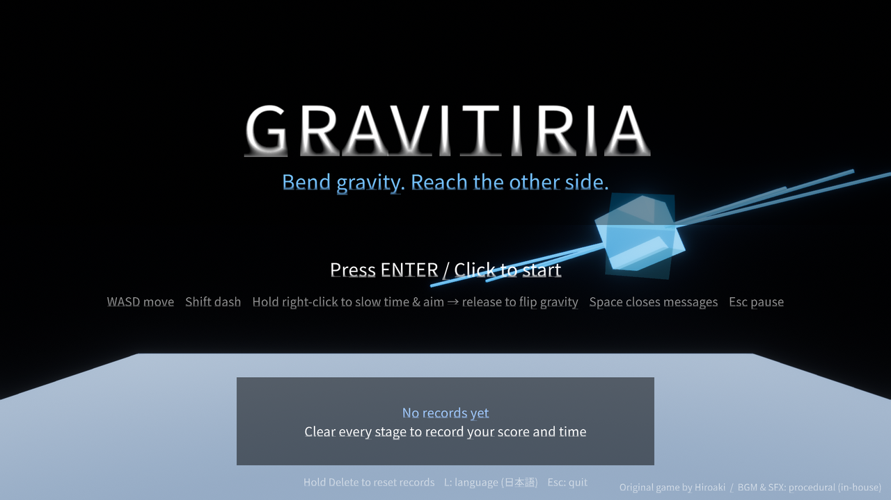
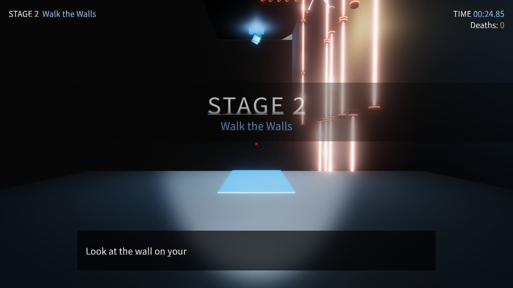
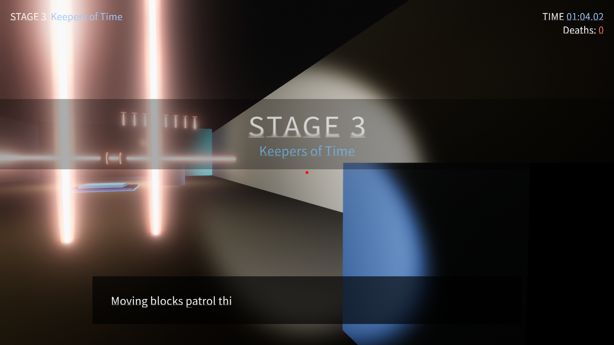
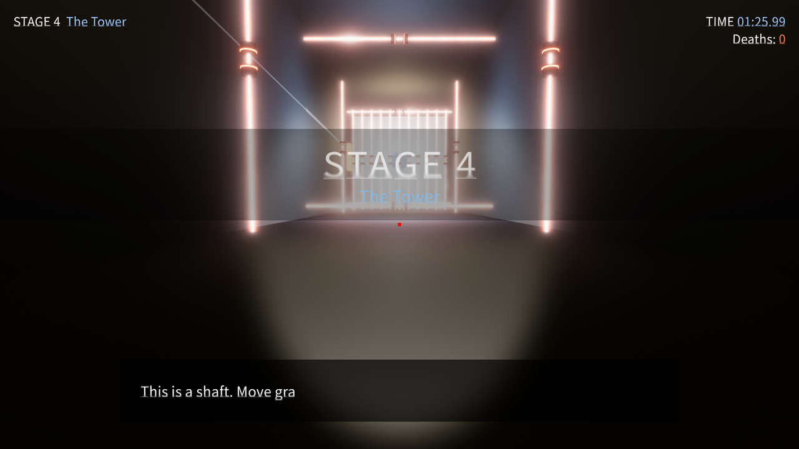
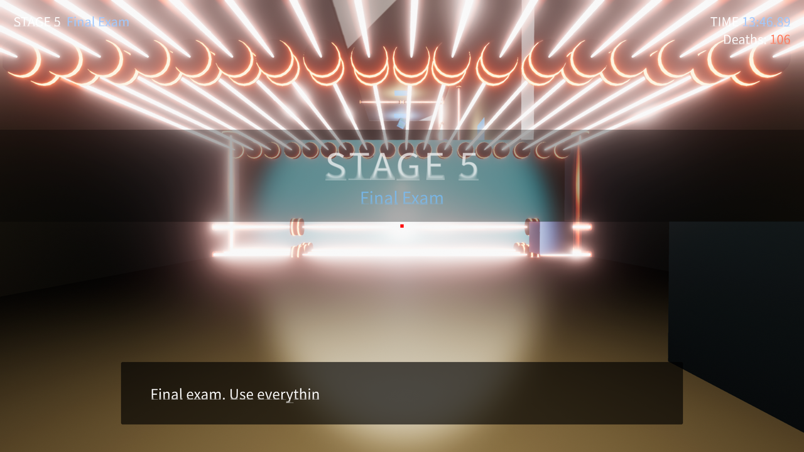
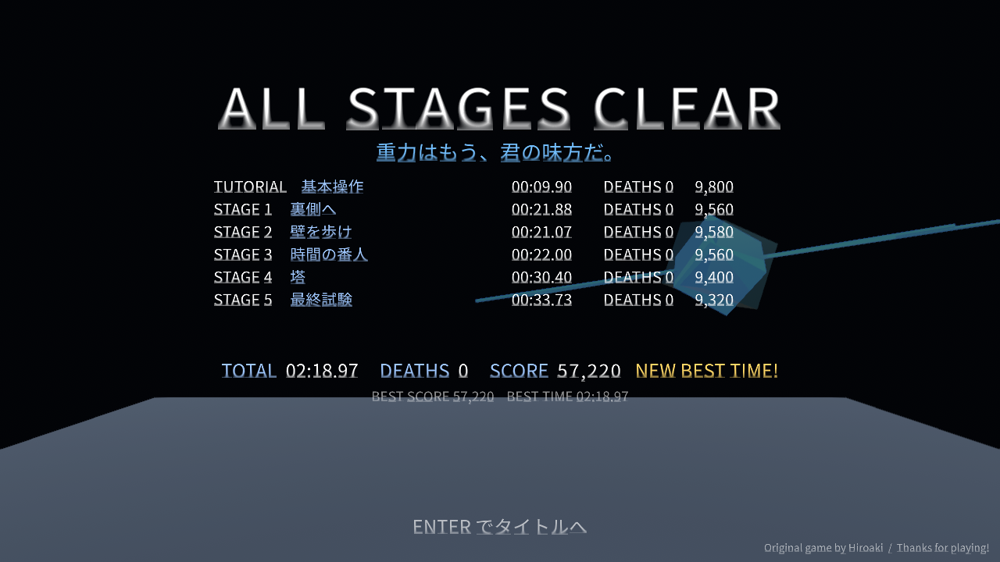

# Gravitiria

**A first-person gravity puzzle. Hold to slow time and aim at any surface. Let go, and that surface becomes the floor.**

Walk on walls and ceilings, slip between security lasers, lure patrol drones onto switches, and reach the white goal at the end of each room. Eleven stages, two unlockable moves, and a run timer that never forgives a death.



| Stage 2 · Walk the Walls | Stage 3 · Keepers of Time | Stage 4 · The Tower | Stage 5 · Final Exam |
|---|---|---|---|
|  |  |  |  |



日本語の説明は [README.ja.md](README.ja.md) にあります。

## What it is

Gravitiria started as a small Unity prototype by Hiroaki: a room, a player, and one idea. Right-click slows time to a crawl and zooms in. Release, and gravity snaps toward whatever you were looking at. Everything else in the game grew out of that single verb.

- **Eleven stages.** A tutorial, five original stages, and five "Remix" stages that use the same vocabulary without a single line of hint text. Colour and light do the explaining.
- **Enemies that obey your gravity.** Patrol drones, magnets that chase you, and laser turrets all fall the way you fall. Flip the room and they flip with you. They also die to lasers, which means they can be used.
- **Unlockable moves.** A dash with a short invincibility window, and a quick four-way gravity snap that skips the aim. Found as pickups, never explained.
- **A run that remembers.** The timer and the death counter survive every respawn. Only starting over from the title resets them. Finish all stages and the ending screen tallies your run and keeps your best.
- **Japanese and English.** The game follows the OS language and can be switched from the title screen.
- **Keyboard, gamepad, or touch.** The same input layer drives all three, so the Android build plays the same game.

## Play it

Download a build from the project's Releases page, or build it yourself (see below).

| Action | Keyboard / Mouse | Gamepad | Touch (Android) |
|---|---|---|---|
| Move | WASD or arrows | Left stick / D-pad | Left half of the screen, floating stick |
| Look | Mouse | Right stick | Swipe the right half |
| Slow time and aim, then flip gravity | Hold right-click, release | Hold A (South), release | Hold the **FLIP** button, drag to aim, release |
| Dash (after unlock) | Shift | X (West) | **DASH** button |
| Quick gravity (after unlock) | Q / E left-right, Z / C down-up | Hold A + D-pad | Arrow pad above FLIP |
| Pause / restart stage / to title | Esc / R / T | Start / Y / Back | **II** button, then on-screen menu |
| Confirm / close a message | Enter, click / Space | A / B | Tap (right side of the screen in a stage) |
| Switch language (title) | L | | Button in the top-right corner |

Things worth knowing before the first run:

- **Lasers kill on touch.** The screen pulses red when you are close to one.
- **Jump pads** throw you off the surface they sit on. They are how you clear lasers strung across a corridor.
- **Stasis fields** (blue fog) slow you and everything inside them.
- **The Keepers** (Stage 3) run on inverted time. Slowing time makes them faster. Do not aim near them.
- **Switches** are coloured. A switch kills the lasers of the same colour. Dying resets both.
- **Falling off the stage** respawns you. The death still counts.

## Stages

| | Title | What it teaches |
|---|---|---|
| Tutorial | Basics | Moving and the first flip |
| Stage 1 | To the Underside | Leave the room behind you and walk on the underside of the floor |
| Stage 2 | Walk the Walls | Turn walls into floors; when the way is blocked, take the ceiling |
| Stage 3 | Keepers of Time | The Keepers' corridor, jump pads, stasis fields |
| Stage 4 | The Tower | Climb a shaft wall by wall; a switch on the north wall clears the laser ceiling |
| Stage 5 | Final Exam | Floor, wall, ceiling, all in one escape |
| Remix 1 | Flip & Key | A switch and its lasers share a colour |
| Remix 2 | Back Door | The exit is somewhere you cannot see without changing gravity |
| Remix 3 | Lure | Drones press buttons too |
| Remix 4 | Blink | Lasers with a rhythm; read it, or dash through it |
| Remix 5 | Final Remix | Everything at once, in a much longer room |

Spoilers and intended solutions live in [docs/LEVEL_GUIDE.md](docs/LEVEL_GUIDE.md).

## Scoring and records

Each stage scores `max(500, 10000 - seconds * 20 - deaths * 750)`. The ending screen sums the stages, and the title screen shows your best total score, best total time, and best time per stage. Records, unlocked moves, and the language choice are stored with `PlayerPrefs`, so they survive updates. Hold Delete on the title screen to wipe them.

## Build it yourself

**Requirements**

- Unity 6. The project file says 6000.0.3f1; it also opens and builds in 6000.5. Install either through Unity Hub.
- For a Windows build: Windows Build Support (included with the editor on Windows).
- For Android: the Android Build Support module (OpenJDK, SDK and NDK tools).
- For the browser version: the Web Build Support module.

The first open takes a few minutes while Unity imports the project and restores packages. Post Processing Stack v2 ships inside `Packages/` so it works on both editor versions.

**Windows, from the command line**

```
"C:\Program Files\Unity\Hub\Editor\<version>\Editor\Unity.exe" -batchmode -nographics -quit -projectPath "<this folder>" -executeMethod BuildScript.BuildWindows -outputDir "<output folder>" -logFile build.log
```

**Android (development APK)**

```
"C:\Program Files\Unity\Hub\Editor\<version>\Editor\Unity.exe" -batchmode -nographics -quit -buildTarget Android -projectPath "<this folder>" -executeMethod AndroidBuildSettings.BuildDevelopmentApk -logFile build_android.log
```

The editor menu has the same entries under **Build > Android**. Settings applied: package name `com.vyth.gravitiria`-style identifier (change it before publishing), minimum API 26, target API automatic, IL2CPP, ARM64, landscape only. Install with `adb install -r Build/Android/Gravitiria.apk`.

**Web (for Unity Play or any static host)**

File > Build Profiles > Web > Switch Platform, then Build. Step-by-step instructions, including publishing to Unity Play and to GitHub, are in [docs/PUBLISHING.md](docs/PUBLISHING.md).

## Project layout

```
Assets/
  Scenes/            Title, Tutorial, Level1-5, R1-5, Ending
  Script/            Runtime code (player, session, lasers, UI, localisation)
  Script/Input/      GameInput and the keyboard, gamepad and touch sources
  Script/Enemies/    Enemy base class, PatrolDrone, Magnet, LaserTurret, LaserBolt
  Editor/            Level generators, prefab builders, post-processing setup, build scripts
  Enemies/ Pickups/  Prefabs generated by the editor scripts
  Obstacle/          Hiroaki's original prefabs (lasers, jump pad, stasis zone, goal)
  Resources/         Audio, fonts, the subtitle UI prefab
Packages/            Manifest plus the embedded Post Processing package
Tools/               Autopilot scripts and the audio generator
docs/                Screenshots and the documents linked below
```

## Automated play-through

The game can play itself. This is how every stage was verified after each change.

```
Gravitiria.exe -autopilot Tools\autopilot_full_run.txt -capture <folder> -lang en
```

The script walks from the title through the stages to the ending and saves a screenshot of each scene. After the 1.0 redesign of Stage 5 and Remix 5, the routes for those two rooms still need re-timing; the rest of the chain runs clean. Progress is written to `%USERPROFILE%\AppData\LocalLow\DefaultCompany\Gravitiria\Player.log` as `[AutoPilot]` lines; `CHAIN COMPLETE` means the whole run succeeded. `-startScene <name>` starts anywhere, `-touchui` forces the touch controls on a PC, and `Tools\autopilot_touch_test.txt` drives them with simulated fingers.

## Documents

- [docs/PRD.md](docs/PRD.md): product requirements, written from the finished game.
- [docs/ARCHITECTURE.md](docs/ARCHITECTURE.md): how the code is put together and why.
- [docs/LEVEL_GUIDE.md](docs/LEVEL_GUIDE.md): stage-by-stage design notes and solutions.
- [docs/PUBLISHING.md](docs/PUBLISHING.md): GitHub and Unity Play, from a blank account.
- [docs/PITCH.md](docs/PITCH.md): the short version, for store pages and posts.
- [CHANGELOG.md](CHANGELOG.md): what changed, in order.

## Credits

- Original game design, the core mechanic and the first levels: **Hiroaki**
- Stages 2 to 5, the Remix stages, enemies, UI, localisation, audio, Android and web work: the Gravitiria contributors
- Font: [Noto Sans JP](https://fonts.google.com/noto/specimen/Noto+Sans+JP), SIL Open Font License 1.1
- Music and sound effects are synthesised by `Tools/make_audio.py`; no third-party samples

License: MIT. See [LICENSE](LICENSE).
